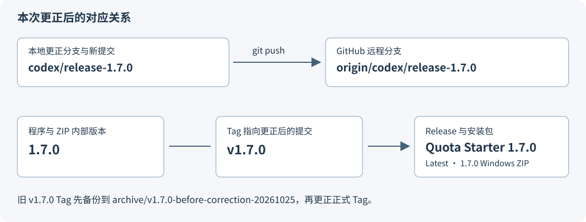
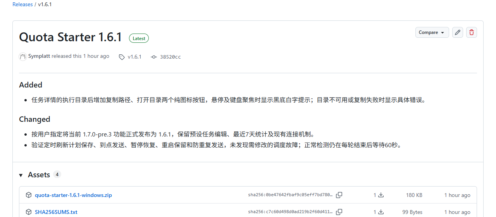
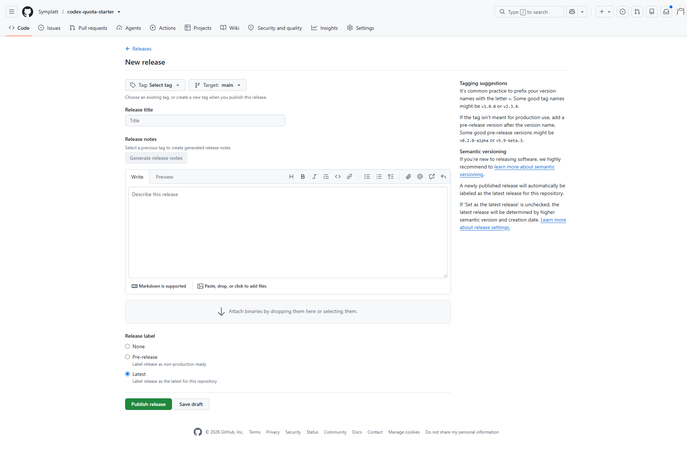

# 将误发布的 1.6.1 更正为 1.7.0

适用仓库：[Symplatt/codex-quota-starter](https://github.com/Symplatt/codex-quota-starter)  
核对日期：2026-10-25；命令环境：Windows PowerShell。

**本文件是供你自行操作的指南。编写文档时只读取了仓库和页面，没有修改源码版本，没有执行 commit、push、Tag 更新或 Release 修改。**

建议顺序：保留当前发布备份 → 修改版本并重新打包 → 新提交、新分支 → 备份并更正旧 Tag → 发布 1.7.0 → 标记 1.6.1 已被更正。

## 1. 先分清需要改的几个位置

| 名称 | 作用 | 本次目标 |
| --- | --- | --- |
| 源码版本 | 决定程序运行时显示什么版本 | `version.py` 中的 `1.7.0` |
| Git 提交 | 保存更正后的源码及文档 | 在现有更新上增加一个更正提交 |
| 分支 | 指向一条开发历史，可继续增加提交 | `codex/release-1.7.0` |
| Tag | 给某个具体提交贴版本标签 | `v1.7.0` 指向更正提交 |
| Release | GitHub 下载页面，关联一个 Tag | 标题 `Quota Starter 1.7.0`，设为正式、Latest |
| Windows ZIP | 用户实际安装的文件 | `quota-starter-1.7.0-windows.zip`，内部版本也为 1.7.0 |

**只改 Release 标题，程序和安装包仍会是 1.6.1；只改 ZIP 文件名，内部源码也不会改变。** 本次应重新打包，再发布到正确的 Tag。



### 已核对的当前状态

| 项目 | 2026-10-25 读取结果 |
| --- | --- |
| 本地项目 | `C:\work-space\quota-starter` |
| 本轮更新提交 | `38520cc964d355bb60078b69e940bbd8de4a5575` |
| 本轮远程分支 | `codex/release-1.6.1`，指向上述提交 |
| 误编号 Release | `v1.6.1`，已发布，非预发布，`immutable=false` |
| 目标远程分支 | `codex/release-1.7.0` 尚不存在 |
| 目标 Release | `v1.7.0` 当前没有 Release 页面 |
| 目标 Tag | **`v1.7.0` 已存在，但指向历史代码，并非本轮更新** |
| 旧 Tag 对象 SHA | `70d2050210325d85a7ccf47cebf83d752e8f84a2` |
| 旧 Tag 对应代码提交 | `7e056740d26d959d64af2849edfdb78e4e809da6` |

所以，不能直接给现有旧 `v1.7.0` 创建 Release，也不能只运行普通的 `git tag v1.7.0`。第 5 节会先保存旧 Tag，再用精确条件替换它。

## 2. 保留当前发布，准备新分支

先打开 [1.6.1 Release 页面](https://github.com/Symplatt/codex-quota-starter/releases/tag/v1.6.1)，将 Windows ZIP 和 `SHA256SUMS.txt` 下载到一个单独的备份文件夹。后续构建会更新项目 `dist\SHA256SUMS.txt`，不要把新的校验文件误当成旧包的校验文件。

下图是本次实际页面。**标题在上方，Tag 和提交号在标题下方，安装包在 Assets 中**；这几个位置需要彼此对应。



打开 PowerShell，以下步骤尽量在同一个窗口中按顺序执行。每段命令报错后先处理，不继续粘贴下一段。

```powershell
Set-Location 'C:\work-space\quota-starter'
git status --short
git fetch origin
if ($LASTEXITCODE -ne 0) { throw '获取远程状态失败' }
```

`git status` 中如果只有本指南及 `docs\asset` 的未跟踪文件，不影响本次操作；如果还有你正在修改的源码，先保存并确认这些修改的归属。

从本轮已交付的正确功能代码建立一个新分支，不重写原来的提交：

```powershell
git switch --no-track -c codex/release-1.7.0 38520cc964d355bb60078b69e940bbd8de4a5575
if ($LASTEXITCODE -ne 0) { throw '创建更正分支失败；如果分支已存在，先检查它，不要强制覆盖' }
```

这里的 `--no-track` 表示先不继承旧分支的上游关联；第 4 节会明确建立正确的关联。

## 3. 修改源码版本并重新打包

用编辑器修改下列文件。**修改当前版本的表述，不要全局替换整个仓库中的历史版本号。**

| 文件 | 修改内容 |
| --- | --- |
| `version.py` | 改为 `VERSION = '1.7.0'` |
| `README.md` | 当前正式版、下载链接、当前发布分支改为 1.7.0、`v1.7.0`、`codex/release-1.7.0`；历史记录保留 |
| `CHANGELOG.md` | 顶部增加 `## [1.7.0] - 2026-10-25`，列出本轮功能，并说明 1.6.1 为误编号，现正式更正；保留原 1.6.1 历史条目 |
| `VALIDATION.md` | 顶部增加 1.7.0 更正说明，注明沿用同一功能代码，重新核验版本和发布包 |
| `AGENTS.md` | 补充本次版本号口误更正记录，避免以后把 1.6.1 当成仍待执行的目标；历史约定无需删除 |

CHANGELOG 新条目可以写成：

```markdown
## [1.7.0] - 2026-10-25

### Added
- 任务详情的执行目录后增加复制路径、打开目录两个图标按钮，悬停显示黑底白字提示。

### Changed
- 正式纳入预设任务编辑、最近7天统计及现有连接机制。
- 将本轮误编号的1.6.1更正为1.7.0，重新生成版本一致的安装包。
```

重新构建：

```powershell
python -X utf8 build_release.py
if ($LASTEXITCODE -ne 0) { throw '打包失败' }
Get-Content .\version.py
Get-ChildItem .\dist\quota-starter-1.7.0-windows.zip
Get-Content .\dist\SHA256SUMS.txt
Get-FileHash .\dist\quota-starter-1.7.0-windows.zip -Algorithm SHA256
```

最后两条输出中的 SHA256 应相同，`SHA256SUMS.txt` 中的文件名应是 **1.7.0**。

再检查 ZIP 内部版本，避免只更改外部名称：

```powershell
@'
from zipfile import ZipFile
with ZipFile('dist/quota-starter-1.7.0-windows.zip') as z:
    version = z.read('quota-starter/version.py').decode('utf-8').strip()
    assert version == "VERSION = '1.7.0'", version
    assert not any('/data/' in name for name in z.namelist())
    print('ZIP内部版本为1.7.0，且不含运行时数据')
'@ | python -X utf8 -
if ($LASTEXITCODE -ne 0) { throw '发布包核验失败' }
```

这次只更正版本，不需要重复运行全量功能测试；需要核对版本、构建结果和后续实际启动版本。

## 4. 提交更正并推送到明确的新分支

```powershell
git add version.py README.md CHANGELOG.md VALIDATION.md AGENTS.md
git diff --cached --check
if ($LASTEXITCODE -ne 0) { throw '暂存内容检查失败' }
git diff --cached
```

确认暂存区只有这次打算提交的更正内容，然后执行：

```powershell
git commit -m 'chore(release): correct stable version from 1.6.1 to 1.7.0'
if ($LASTEXITCODE -ne 0) { throw '提交失败' }

git push --dry-run origin HEAD:refs/heads/codex/release-1.7.0
if ($LASTEXITCODE -ne 0) { throw '推送预检查失败' }

git push --set-upstream origin HEAD:refs/heads/codex/release-1.7.0
if ($LASTEXITCODE -ne 0) { throw '分支推送失败' }

git branch -vv
```

`--dry-run` 只预览推送结果。正式命令中的两端含义如下：

```text
HEAD  :  refs/heads/codex/release-1.7.0
本地当前提交          远程目标分支
```

输出的目标必须是 **`codex/release-1.7.0`**；上游应显示为 **`origin/codex/release-1.7.0`**。使用完整目标引用，可以避免沿用旧的 1.6.1 或预发布分支映射。

原 `codex/release-1.6.1` 分支可以保留作为历史记录。创建新分支并不要求删除旧分支，也不需要强推 `main`。

## 5. 先备份旧 v1.7.0 Tag，再指向更正提交

### 5.1 核对旧 Tag 没有发生变化

```powershell
git ls-remote origin refs/tags/v1.7.0 'refs/tags/v1.7.0^{}'
```

本指南核对时的结果是：

```text
70d2050210325d85a7ccf47cebf83d752e8f84a2  refs/tags/v1.7.0
7e056740d26d959d64af2849edfdb78e4e809da6  refs/tags/v1.7.0^{}
```

第一行是带说明的 Tag 对象，第二行是它最终指向的代码提交；两者本来就可以不同。若结果变了，先查明原因，不直接继续替换。

### 5.2 保存旧 Tag 原对象

下面直接把远程旧 Tag 取到一个独立的本地备份名称，再上传备份。它保留旧 Tag 对象及其指向的历史代码。

```powershell
git fetch origin refs/tags/v1.7.0:refs/tags/archive/v1.7.0-before-correction-20261025
if ($LASTEXITCODE -ne 0) { throw '备份旧Tag失败' }

git push origin refs/tags/archive/v1.7.0-before-correction-20261025:refs/tags/archive/v1.7.0-before-correction-20261025
if ($LASTEXITCODE -ne 0) { throw '上传旧Tag备份失败' }

git ls-remote origin refs/tags/archive/v1.7.0-before-correction-20261025
```

备份行的 SHA 应为 `70d2050210325d85a7ccf47cebf83d752e8f84a2`。

### 5.3 更正正式 Tag

确认仍在 `codex/release-1.7.0`，且当前提交就是第 4 节新建的更正提交：

```powershell
git branch --show-current
git log -1 --oneline
```

再执行：

```powershell
git tag -f -a v1.7.0 -m 'Quota Starter 1.7.0' HEAD
if ($LASTEXITCODE -ne 0) { throw '创建本地正式Tag失败' }

git push --force-with-lease=refs/tags/v1.7.0:70d2050210325d85a7ccf47cebf83d752e8f84a2 origin refs/tags/v1.7.0:refs/tags/v1.7.0
if ($LASTEXITCODE -ne 0) { throw 'Tag更新失败；先检查远程状态，不要改用无条件强推' }

git rev-parse HEAD
git ls-remote origin refs/tags/v1.7.0 'refs/tags/v1.7.0^{}'
```

`--force-with-lease=引用:旧SHA` 的含义是：**只有远程仍指向我们已核对的旧对象时，才允许替换**。它的作用范围只有这个 Tag，不会重写其他分支。这里的第二行 `refs/tags/v1.7.0^{}` 应与 `git rev-parse HEAD` 完全一致。[Git 官方说明](https://git-scm.com/docs/git-push#Documentation/git-push.txt---force-with-leaseltrefnamegtltexpectgt)

若 GitHub 提示 Tag 保护或不可变 Release 限制，停止这一步并核对限制来源。本次读取时 `v1.7.0` 没有 Release，但仓库状态以后可能改变；曾绑定不可变 Release 的 Tag 名称可能不能再次使用。[GitHub 不可变 Release 说明](https://docs.github.com/en/code-security/concepts/supply-chain-security/immutable-releases)

## 6. 在 GitHub 发布正确的 1.7.0 Release

打开 [Releases 列表](https://github.com/Symplatt/codex-quota-starter/releases)，点击 **Draft a new release**，或打开[新建页面](https://github.com/Symplatt/codex-quota-starter/releases/new)。

下图是本次读取到的实际空白表单，没有输入或保存任何发布内容。图中默认 `Target: main` **不是本次应采用的目标代码**。



按照表单从上到下填写：

| 页面位置 | 本次操作 |
| --- | --- |
| `Tag: Select tag` | 选择第 5 节已更正的现有 `v1.7.0`，不要误选 `v1.7.0-pre.3` |
| `Target` | 如果选择现有 Tag 后仍显示这个控件，选择 `codex/release-1.7.0`；实际发布源码由现有 Tag 决定，因此仍须核对第 5 节的提交号 |
| `Release title` | 填写 `Quota Starter 1.7.0` |
| `Release notes` | 粘贴 CHANGELOG 中 1.7.0 的实际变更，说明 1.6.1 为误编号；不要直接复制旧页面里“正式发布为1.6.1”的旧文案 |
| `Attach binaries…` 上传区 | 上传新生成的 `dist\quota-starter-1.7.0-windows.zip` 和 `dist\SHA256SUMS.txt` |
| `Release label` | 选择 **Latest**，不要选 **Pre-release**；如果你看到旧版复选框界面，则取消预发布并启用设为最新版本 |
| 页面底部 | 可先 **Save draft**，核对 Tag、附件及说明后，再 **Publish release** |

这是正式发布，不是 `1.7.0-pre.4`。页面自动生成的 `Source code (zip)` 是源码归档，不能代替你上传的 Windows 安装包。

发布后应得到：

- 正式页面：`https://github.com/Symplatt/codex-quota-starter/releases/tag/v1.7.0`
- 标题：`Quota Starter 1.7.0`
- 标识：`Latest`，没有 `Pre-release`
- 附件：`quota-starter-1.7.0-windows.zip` 和 `SHA256SUMS.txt`
- 页面提交号：第 4 节的新更正提交，而不是历史 `7e05674`

新建、编辑、删除 Release 是独立的 GitHub 操作，不由 `git push` 自动完成。[GitHub 官方发布操作说明](https://docs.github.com/en/repositories/releasing-projects-on-github/managing-releases-in-a-repository)

## 7. 最后处理误编号的 1.6.1

**建议保留历史页面和 Tag，并明确标为已更正。** 在确认 1.7.0 已可下载后，进入原 [1.6.1 页面](https://github.com/Symplatt/codex-quota-starter/releases/tag/v1.6.1)，点击右上角铅笔图标编辑。

建议把标题改为：

```text
Quota Starter 1.6.1（版本号误记，已更正为1.7.0）
```

在说明顶部加入：

```markdown
本轮发布的版本号误记为1.6.1，现已更正为正式版1.7.0。
请下载：[Quota Starter 1.7.0](https://github.com/Symplatt/codex-quota-starter/releases/tag/v1.7.0)。
本页面仅保留历史记录。
```

原页面不再设为 Latest；新 1.7.0 页面保持 Latest。旧 Tag 不动，旧附件也保持原样，不把新安装包混放进旧 Release。

如果你希望彻底撤下旧下载页面，可以在备份后删除 **1.6.1 Release**；删除 Release 与删除 Git Tag 是两件事，旧 Tag 可以继续保留。新 1.7.0 可用之前，不先删掉唯一可用的正式下载页面。

## 8. 覆盖安装及最终核对

如果希望本机软件也显示 1.7.0，从新发布页面下载 Windows ZIP，解压到一个独立文件夹，然后运行解压目录中的 `Install.cmd`。当前本机使用默认安装目录；安装器会覆盖程序并保留现有数据。不要在已安装目录内直接运行 `Install.ps1`。

启动后刷新原来的 `http://127.0.0.1:8769/`，核对软件信息显示 1.7.0。若你在另一台使用源码目录运行的电脑操作，则沿用那台电脑的源码启动方式，不需要额外创建默认安装副本。

- [ ] `version.py` 为 1.7.0，README 当前版本及链接一致。
- [ ] 新分支推送到 `origin/codex/release-1.7.0`，上游关联正确。
- [ ] 旧 v1.7.0 Tag 已在 `archive/v1.7.0-before-correction-20261025` 保存。
- [ ] 正式 `v1.7.0` 的代码提交等于本次更正提交。
- [ ] GitHub Actions 对应检查通过。
- [ ] 1.7.0 Release 为正式版、Latest，附件文件名和内部版本均正确。
- [ ] 下载后的新 ZIP 的 SHA256 与同页 `SHA256SUMS.txt` 一致。
- [ ] 1.6.1 页面已标注更正，或已在备份后撤下；不再是最新正式版。
- [ ] 本机启动版本为 1.7.0，原有计划、任务、数据和自启偏好保留。

## 图片文件与 Typora

本指南的图片使用同级 `asset` 文件夹和相对路径：

```text
docs/
├─ 版本号更正操作指南-1.6.1到1.7.0.md
└─ asset/
   ├─ version-correction-flow.svg
   ├─ release-1.6.1-current.png
   └─ release-new-form.png
```

图片引用示例：``。移动或复制文档时，把 `asset` 文件夹一起带走即可。
